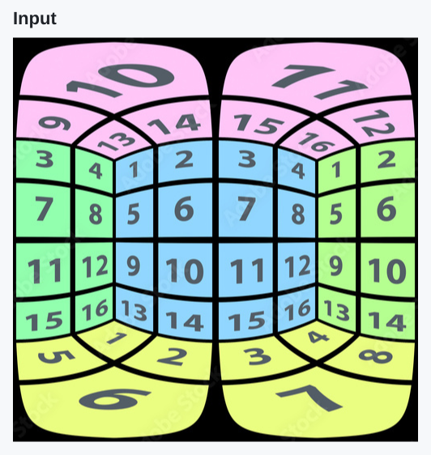
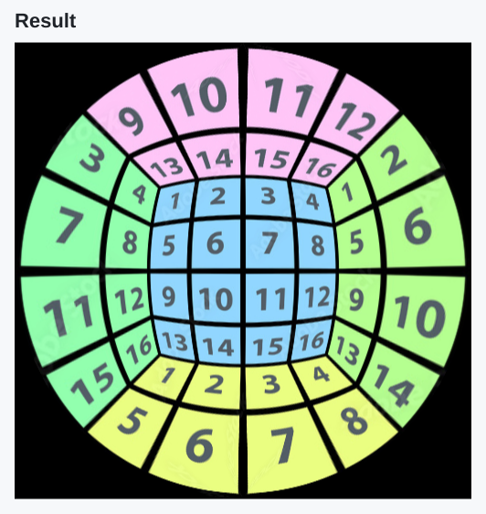
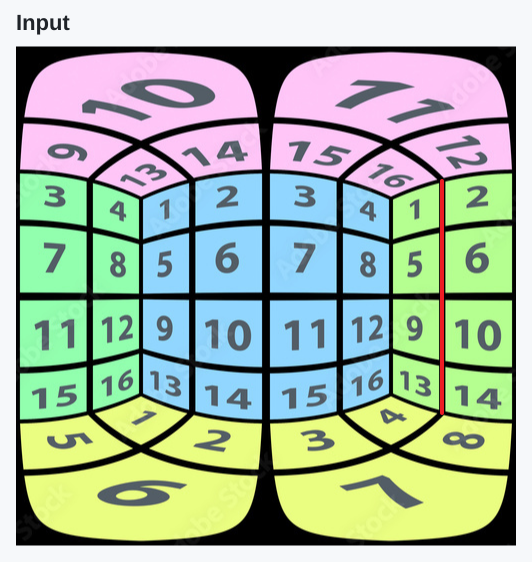
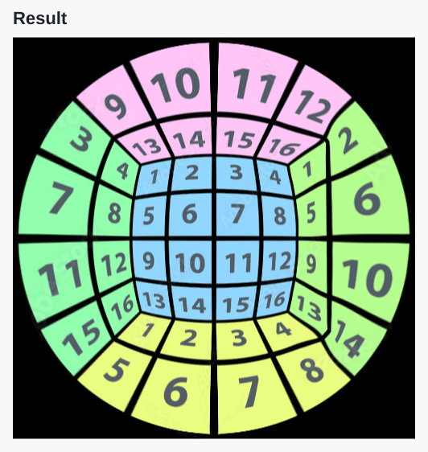
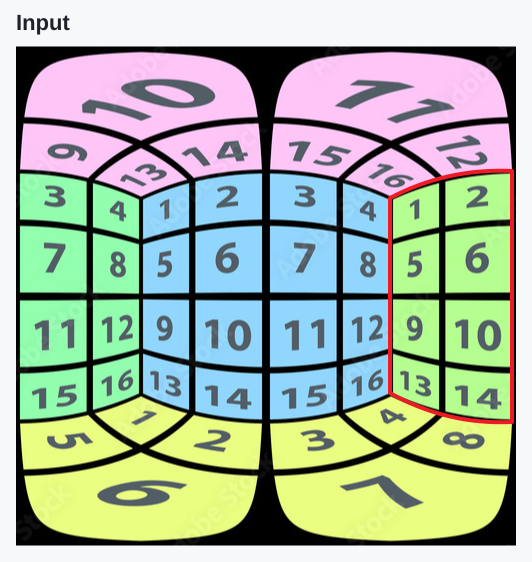
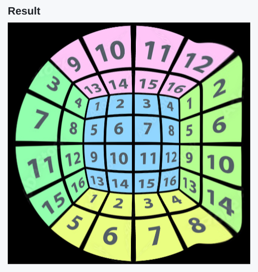

# Interactive Marginal Distortion Correction

A Python implementation of [MaDCoW (CVPR 2025)](https://openaccess.thecvf.com/content/CVPR2025/html/Zhang_MaDCoW_Marginal_Distortion_Correction_for_Wide-Angle_Photography_with_Arbitrary_Objects_CVPR_2025_paper.html) with interactive annotation tools for wide-angle photographs and panorama views. SAM2-assisted ROI masks and snapped structural annotations let users guide object appearance and scene geometry through a GUI workflow.

[Examples](#correction-examples) · [Quick start](#quick-start) · [Results and analysis](docs/results.md) · [Annotation guide](docs/usage.md)

## Project contributions

- **MaDCoW implementation.** Local ROI projection fitting, angular-mesh initialization, global warp optimization, rendering, and optional validity-mask cropping.
- **Assisted annotation tools.** SAM2 point/box prompts with mask cleanup, plus stroke snapping for real-world straight structures that may appear straight or curved in the input image.
- **GUI workflow.** Camera/view setup, ROI and line annotation, correction progress, and output preview are available through GUIs. The annotation stages share one coordinate system.

## Correction examples

The numbered pattern illustrates the separate effects of structural and region constraints.

### Without annotations

<p>
  <a href="docs/assets/numbered-input.svg"></a>
  <a href="docs/assets/numbered-unconstrained.svg"></a>
</p>

The unconstrained output follows the stereographic initialization and regularization, leaving the right-hand divider curved.

### Line constraint

<p>
  <a href="docs/assets/numbered-line-input.svg"></a>
  <a href="docs/assets/numbered-line-result.svg"></a>
</p>

The selected vertical divider becomes straighter under the line constraint.

### ROI constraint

<p>
  <a href="docs/assets/numbered-roi-input.svg"></a>
  <a href="docs/assets/numbered-roi-result.svg"></a>
</p>

The selected green block receives a local projection target, changing its shape within the global warp. [Results and analysis](docs/results.md) cover the photographic examples, annotation tradeoffs, and failure cases.

## Quick start

Use a Bash shell and an interactive desktop display for the Matplotlib GUIs. See the [installation notes](docs/usage.md#installation) for environment requirements.

```bash
git clone https://github.com/ljc-1222/marginal-distortion-correction.git
cd marginal-distortion-correction
bash setup.sh --sam2-model small
source .venv/bin/activate
```

Open the integrated annotator with the bundled image:

```bash
python annotate.py --image data/test1/image.png --workspace annotation/test1
```

Choose **Small**, confirm the camera/view setup, create the ROI and line annotations, and save. Then open the correction runner:

```bash
python run_mad.py
```

Select `annotation/test1/annotation.json`, choose the output and crop settings, and run correction. The [annotation guide](docs/usage.md) includes controls, output files, and CLI commands.

## Documentation

| Guide | Contents |
| :--- | :--- |
| [Using the system](docs/usage.md) | Installation, annotation, and correction |
| [Results and analysis](docs/results.md) | Constraint effects, design choices, and limitations |
| [MaDCoW implementation](MaDCoW/README.md) | Geometry, optimization, and configuration |
| [Development reference](docs/development.md) | File layout, annotation contract, and checks |

## Credits

Computational Photography final project by [@ljc-1222](https://github.com/ljc-1222) and [@tuna00662244](https://github.com/tuna00662244), National Tsing Hua University.

The annotation tools use [SAM 2](https://github.com/facebookresearch/sam2). [ULSD](ULSD/README.md) is retained as an explored automatic line-candidate frontend. See the [source acknowledgments](docs/development.md#sources-and-licenses) for the underlying research, code, and licenses.
