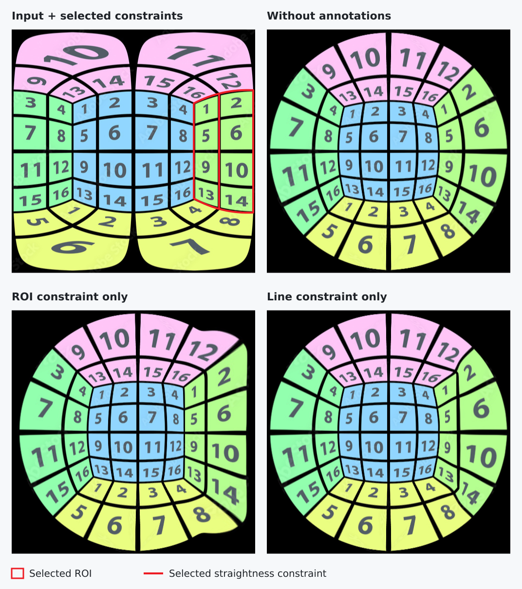

# Interactive Marginal Distortion Correction

An interactive system for correcting marginal distortion in wide-angle photographs and panorama views. It combines a Python implementation of **MaDCoW** with **SAM2-assisted region selection** and **stroke snapping for structural constraints**, so users can guide both object appearance and scene geometry.

[Quick start](#quick-start) · [Results and analysis](docs/results.md) · [Annotation guide](docs/usage.md)



*Top: original view and correction without annotations. Middle: line-marked input and line-only result. Bottom: ROI-marked input and ROI-only result.*

## What the project implements

- **A complete correction pipeline.** Fit local projections for selected regions, initialize an angular mesh, optimize a global warp, and render the corrected image with optional validity-mask cropping.
- **Assisted constraint creation.** Use point or box prompts to generate ROI masks with SAM2, then draw rough strokes that snap to nearby image structures. Mask cleanup removes small components and fills holes before export.
- **An integrated GUI workflow.** Camera/view setup, ROI and line annotation, correction progress, and output preview are available through GUIs, with one shared coordinate system for the annotations.

The correction formulation follows [MaDCoW, CVPR 2025](https://openaccess.thecvf.com/content/CVPR2025/html/Zhang_MaDCoW_Marginal_Distortion_Correction_for_Wide-Angle_Photography_with_Arbitrary_Objects_CVPR_2025_paper.html). This project implements the correction workflow and builds the annotation tools around it.

## How the constraints affect the result

ROI masks identify objects whose local appearance should be preserved. Structural annotations identify real-world straight features, including features that appear curved in the input image. MaDCoW combines these targets with conformality and smoothness terms to determine the final warp.

The numbered example presents each treatment as its own input-output pair. The middle row shows how a line constraint straightens the selected vertical divider; the bottom row shows how an ROI constraint guides the local projection of the right-hand green block. The [results and analysis](docs/results.md) also include panorama and portrait examples, local comparisons, and observed failure cases.

## Quick start

Use a Bash shell and a Python environment compatible with the [recorded dependencies](requirements.txt). The Matplotlib interfaces require a desktop display. See the [installation notes](docs/usage.md#installation) for the environment and checkpoint details.

```bash
git clone https://github.com/ljc-1222/marginal-distortion-correction.git
cd marginal-distortion-correction
bash setup.sh --sam2-model small
source .venv/bin/activate
```

Start the integrated annotator with the bundled image:

```bash
python annotate.py --image data/test1/image.png --workspace annotation/test1
```

Choose the installed **Small** model, confirm the camera/view setup, create ROI masks, and accept snapped structural annotations. Saving writes `annotation/test1/annotation.json` together with the required masks and any derived panorama view.

Run correction with the saved annotation:

```bash
python run_mad.py \
    --annotations annotation/test1/annotation.json \
    --output outputs/test1/image_corrected.png \
    --summary outputs/test1/summary.json \
    --crop
```

Omit `--crop` to retain the full rendered output. Run `python annotate.py` or `python run_mad.py` without arguments to use their file-selection GUIs. The [annotation guide](docs/usage.md) explains view selection, ROI prompts, snapping modes, and output files.

## Documentation

| Guide | Contents |
| :--- | :--- |
| [Using the system](docs/usage.md) | Installation, annotation, and correction |
| [Results and analysis](docs/results.md) | Constraint effects, design choices, and limitations |
| [MaDCoW implementation](MaDCoW/README.md) | Geometry, optimization, and configuration |
| [Development reference](docs/development.md) | File layout, annotation contract, and checks |

## Credits

Computational Photography final project by [@ljc-1222](https://github.com/ljc-1222) and [@tuna00662244](https://github.com/tuna00662244), National Tsing Hua University.

The system builds on [MaDCoW](https://openaccess.thecvf.com/content/CVPR2025/html/Zhang_MaDCoW_Marginal_Distortion_Correction_for_Wide-Angle_Photography_with_Arbitrary_Objects_CVPR_2025_paper.html) by Zhang et al. and [SAM 2](https://github.com/facebookresearch/sam2) by Ravi et al. [ULSD](ULSD/README.md) is retained as an explored automatic line-candidate frontend. See the [source acknowledgments](docs/development.md#sources-and-licenses) for upstream code and licenses.
