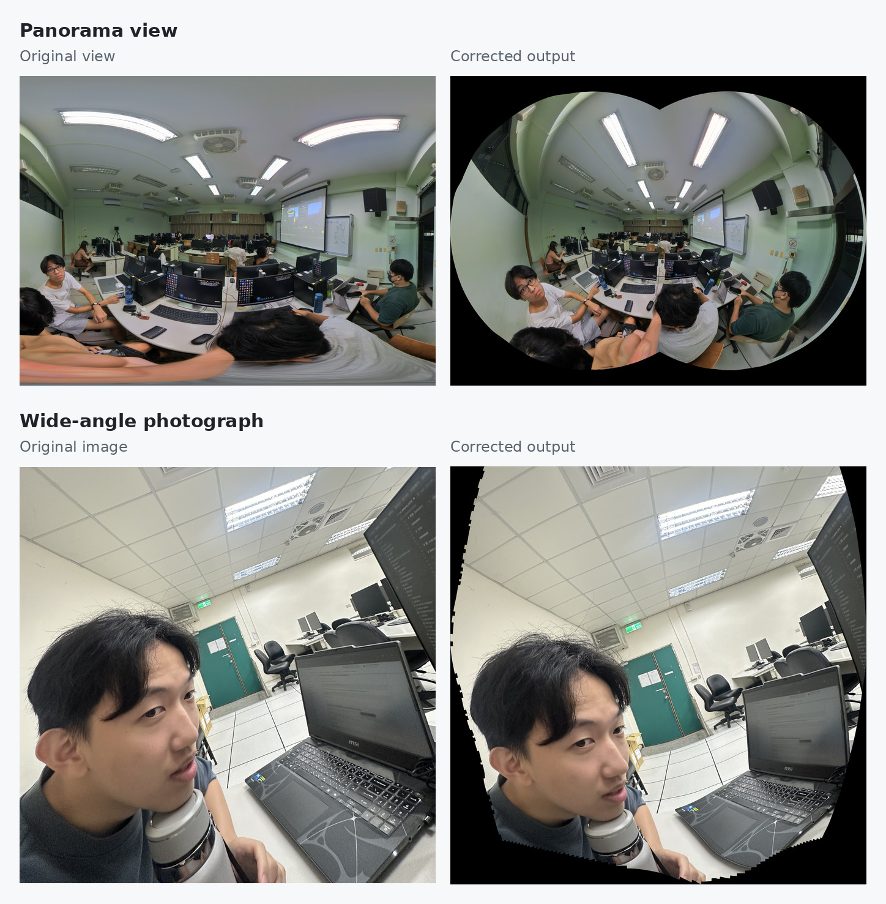
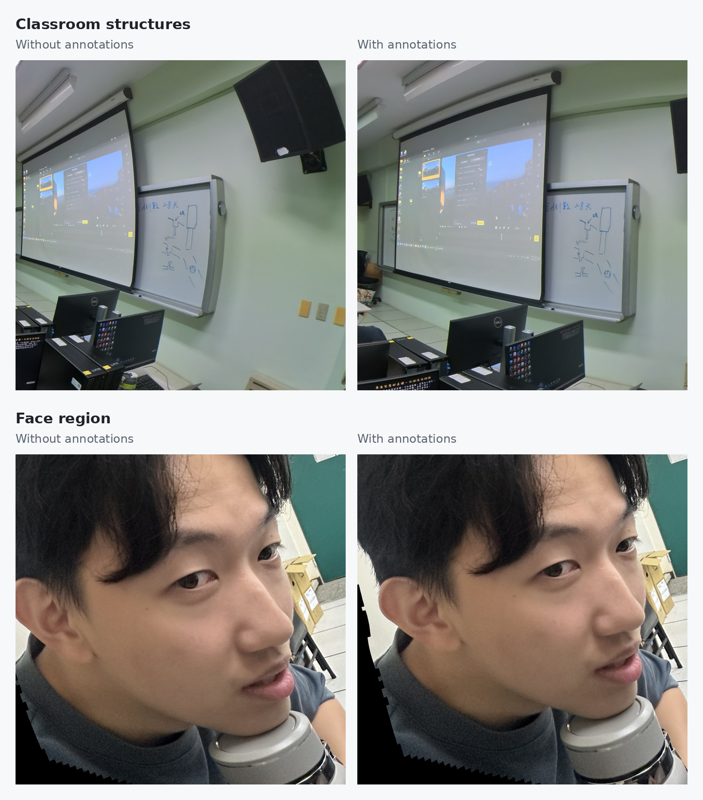
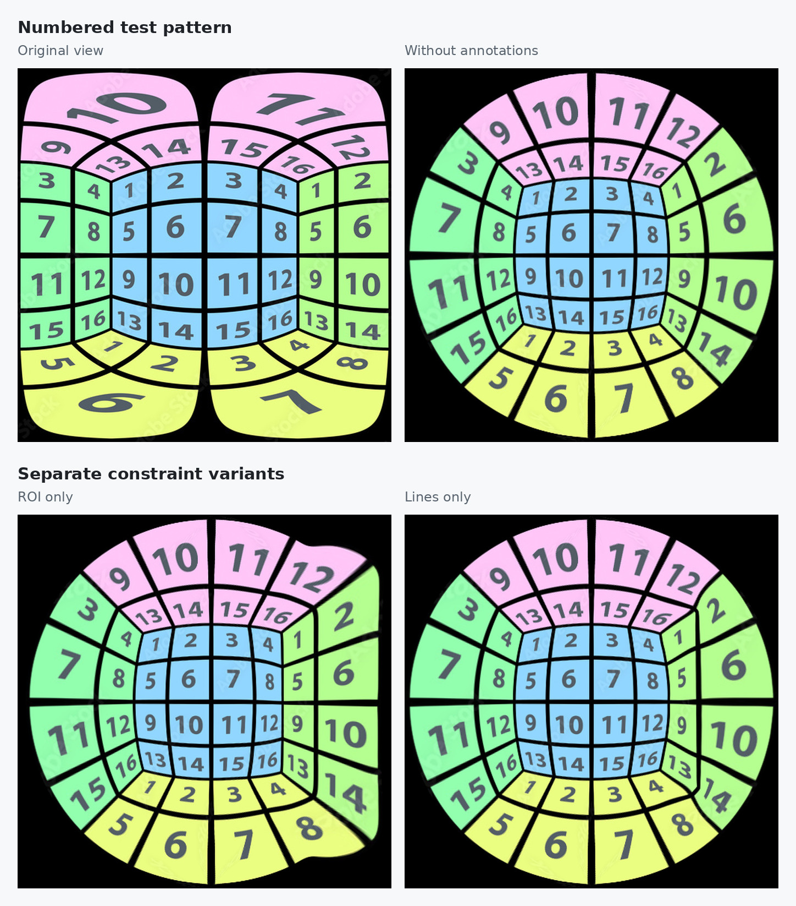
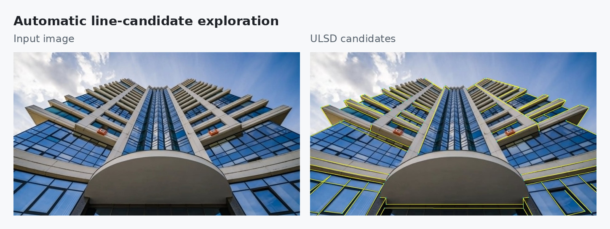
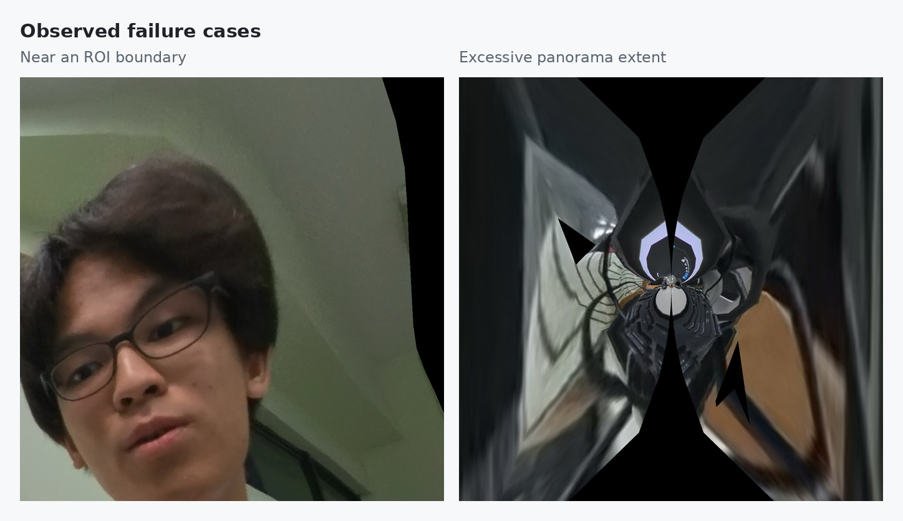

# Results and design analysis

[Project overview](../README.md) · [Using the system](usage.md)

The qualitative project experiments examine a classroom panorama view and a pinhole wide-angle portrait. The comparisons focus on the visual effect of user constraints: preserving selected objects while guiding scene structures through a global warp.

## Global correction

In the classroom example, correction redistributes the wide field of view across the output. In the portrait example, the local face projection changes together with the surrounding ceiling, desks, and floor. The black areas in the corrected panels are outside the rendered valid image region; the examples retain these borders to show the full output extent.

Global shape changes alone do not explain the effect of annotation. The local comparisons below show where the user constraints influence the result.

## ROI and structural constraints

**Classroom structures.** The annotated result changes the projection screen and whiteboard boundaries relative to the unconstrained output. The structural annotations give the optimizer explicit straightness targets instead of leaving those features to the projection and regularization terms alone.

**Face appearance.** The ROI constraint guides the face toward its fitted local projection. This changes the shape around the forehead, cheek, and nose while the rest of the image adapts through the global warp. The selected region and its surrounding background remain coupled, which also explains the boundary artifacts discussed below.

These panels are the corresponding local crops used in the project experiments. Each crop keeps its original aspect ratio; the same scene features can move or change scale between warps.

The numbered pattern separates the roles of the constraints. Without annotations, the output is mainly determined by the stereographic initialization and regularization. ROI constraints guide a selected region toward a local projection, while line constraints guide structural straightness. The separate variants illustrate why the final workflow accepts both kinds of information. The local photographs above compare the combined annotation workflow with the unannotated setting.

## Why use interactive snapping?

The project also explored ULSD as an automatic line-candidate frontend. In the tested building image, the detections include fragmented structures, responses on secondary edges, and uneven coverage of useful geometric constraints. Changing detection thresholds did not remove the need to select which structures should guide MaDCoW.

[ULSD](https://www.sciencedirect.com/science/article/pii/S0924271621001623) represents distorted line segments with Bézier curves and supports pinhole, fisheye, and spherical imagery. For this project, interactive snapping gives users direct control over which of these structures become correction constraints.

The integrated workflow lets the user choose a meaningful structure and refines the stroke using local edge, orientation, color, continuity, and distance evidence. The user reviews that result before export. `Line` and `Curve` modes describe the input image trace; both can represent a real-world straight feature. Algorithm details are in the [snapping reference](../interactive_snapping_2d/README.md).

The [ULSD frontend](../ULSD/README.md) remains available as a separate experimental path, including automatic detection and manual review of line candidates.

## Observed limitations

**Distortion near ROI boundaries.** Preserving an ROI can shift deformation into neighboring background regions. This becomes visible when strong structures sit close to the selected object. Softer boundary weights or boundary-aware regularization are possible follow-up directions.

**Excessive panorama extent.** Very wide selected views can produce heavily stretched or collapsed output meshes. The example illustrates a practical limit of the current workflow. Restricting view extent or checking mesh validity before rendering could make this failure easier to handle.

**Phone ultra-wide example.** In a tested 0.6× phone image with an effective FOV of about 114°, linear-projection initialization produced a more satisfactory result than stereographic initialization. The project report attributes this behavior to the smaller FOV; this remains an explanation for that case rather than a universal FOV threshold. The phone image was excluded from the final successful-example comparisons.

## Figure sources

The visual examples come from the project's final-report assets and are arranged for this repository. The [asset source list](assets/SOURCES.md) records the original filenames and presentation changes.
